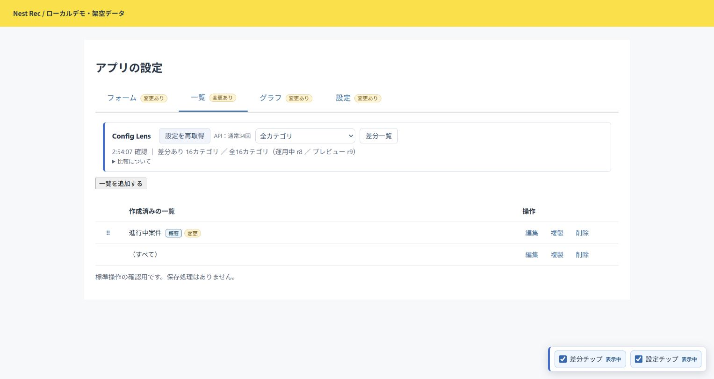
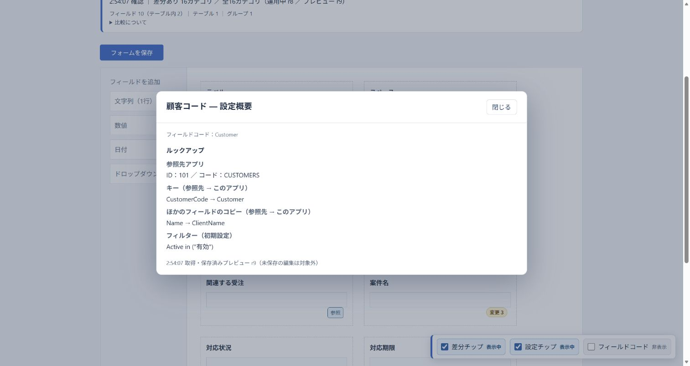

# kintone Config Lens

**kintoneの設定を、開かず確認。変更点もひと目で。**

アプリの設定画面に、設定概要のチップと反映前の差分確認を追加する無料のユーザースクリプトです。標準の編集・保存操作を使いながら、必要な情報だけを確認できます。

**v0.9.1 公開ベータ版** · MIT License · Tampermonkey向け

[ダウンロード・リリースノート](https://github.com/youtotto/kintone-config-lens/releases/tag/v0.9.1) ｜ [スクリプトを開く](https://github.com/youtotto/kintone-config-lens/releases/download/v0.9.1/kintoneConfigLens.user.js) ｜ [不具合・改善提案](https://github.com/youtotto/kintone-config-lens/issues)



画像は架空データによるローカルデモです。

## できること

| 場所 | 確認できること |
| --- | --- |
| フォーム | 選択肢、計算式、ルックアップ元・キー・コピー先・絞り込み、関連レコードの設定概要 |
| フォーム | フィールドコード、スペース・ラベル・罫線の要素ID、フィールド数 |
| フォーム配置 | 運用中と保存済みプレビューの配置を左右の図で比較 |
| 一覧・グラフ | 行へのホバーで概要、追加・変更チップから差分確認 |
| タブ・設定メニュー | 「変更あり」の表示と、取得済みの差分への入口 |
| 個別設定画面 | 取得済みの差分確認と、同じカテゴリ内の設定ページ切り替え |

ルックアップとコピー先は同じ色・番号で対応を示します。表示切替は右下に常設し、すべて非表示にするとフォームのチップ用余白も取り除きます。



## インストール

1. ブラウザに [Tampermonkey](https://www.tampermonkey.net/) を導入します。
2. [v0.9.1のスクリプト](https://github.com/youtotto/kintone-config-lens/releases/download/v0.9.1/kintoneConfigLens.user.js) を開き、Tampermonkeyでインストールします。
3. ダウンロードだけされる場合は、ファイルをテキストで開いて全文をコピーし、Tampermonkeyの「新規スクリプトを追加」に貼り付けて保存します。
4. kintoneの「アプリの設定」を開きます。すでに開いている場合は、編集中の内容を保存してからページを再読み込みしてください。

これは **kintoneプラグインのZIPではありません**。利用するブラウザごとに導入します。ブラウザのユーザースクリプト実行許可が必要な場合は [Tampermonkey公式の案内](https://www.tampermonkey.net/faq.php?locale=ja&q=Q209) を確認してください。

### QuickTabsを利用中の場合

- 単体の「kintone Admin: Quick Tabs」は無効にしてください。同じカテゴリ内のナビゲーションを本ツールに含んでいます。
- 今後の更新は [Releases](https://github.com/youtotto/kintone-config-lens/releases) で確認し、配布ファイルで既存スクリプトを更新してください。

## 使い方

1. **「設定を読み込む」**を押します。毎回、対応する全16カテゴリを取得します。
2. チップにホバーして設定概要を確認します。一覧・グラフでは行へのホバーでも確認できます。
3. 「変更」「追加」チップ、またはカテゴリを選んで「差分一覧」から変更前後を確認します。
4. 配置を確認するときは「フォーム配置」を選びます。
5. 設定を保存したら **「設定を再取得」**を押して最新の保存内容を比較します。

比較するのは **運用中の設定と、保存済みのプレビュー設定** です。未保存の編集は含みません。差分を確認するために「アプリを更新」を押す必要はありません。

上部の「差分あり ○カテゴリ」は変更のあるカテゴリ数です。カテゴリ選択後の件数は、そのカテゴリ内の差分項目数です。タブは「変更あり」と表示し、ホバーで内訳を確認できます。

## API通信とデータの扱い

- 初期表示では設定取得APIを呼びません。有効な一時保持があれば表示を復元します。
- 読み込み／再取得ボタンを押したときに設定取得の **34回のGET**（16カテゴリ×運用中・プレビュー＋整合性確認2回）と、アップロード済みJS・CSS・アイコン画像の内容取得を実行します。同じファイルキーの内容取得は1回にまとめます。取得失敗・中断時は回数が異なる場合があります。
- ホバー、カテゴリ切替、表示オン／オフ、取得済み差分の表示では追加取得しません。チップを非表示にする操作は、実行中の手動取得を中断する操作ではありません。
- 設定取得はログイン中のkintoneに対して行います。スクリプトによる設定書き込み、レコード取得、アプリ更新、外部サーバーへの設定情報送信は行いません。
- 比較結果・必要な設定データ・表示状態を同じタブの `sessionStorage` に30分間保持します。バックアップではありません。期限切れや保存容量の制限により復元できない場合は再取得してください。
- 標準の保存操作を検知すると「比較未更新」を表示します。他タブからの変更や、検知対象以外の保存方法は検知できません。

## 比較対象と制約

全16カテゴリ：フォーム項目、フォーム配置、一覧、プロセス管理、通知3種、アクセス権3種、一般設定・高度な設定、グラフ・定期レポート、アプリアクション、JavaScript・CSS、プラグインの追加・有効状態、アプリ管理者用メモ。

- APIトークン、Webhook、カテゴリー、言語ごとの名称などは比較対象外です。チップがないことは「変更なし」を保証しません。
- JavaScript・CSSは登録情報と順序に加え、アップロードしたファイルの内容をSHA-256で比較します。アイコン画像も内容を比較し、取得用のファイルキーだけの違いは変更に含めません。同名・同サイズでも内容が違えば検出します。同じURLの配信内容は比較しません。
- ファイルの内容は「設定を読み込む／設定を再取得」の際に同じkintone環境から取得します。取得・照合できない場合は「一部比較不可」と表示します。ファイル本文は実行・保存・外部送信しません。
- プラグイン内部の設定・バージョンは比較しません。
- フィールドコードの変更は削除＋追加として表示します。通知・権限のルール配列は順序を含めて1項目として比較します。
- 権限などで情報が取得できない場合は「取得失敗」「一部比較不可」として区別します。未反映の新規アプリなど運用中設定がない場合、比較できないことがあります。
- フォーム配置はAPIから再現した模式図です。kintoneの画面をピクセル単位で再現するものではありません。
- 一覧・グラフの行は保存済みの名前で対応付けます。未保存の改名や重複名など、対応を確定できない行には概要チップを付けません。
- 設定チップを表示するとフォームの高さが増えます。標準の配置を確認するときは下部バーで全チップを非表示にしてください。
- kintone標準画面のDOMを利用するため、kintoneの更新で補助表示が動かなくなる可能性があります。問題がある場合はスクリプトを無効にすると標準画面に戻せます。

## 対応環境・検証範囲

- PC版kintoneのアプリ設定画面。設定閲覧に必要な権限を持つユーザーで利用します。
- 実機検証：Windows / Microsoft Edge / Tampermonkey / cybozu.comの通常スペース。
- URL判定は `*.cybozu.com`・`*.kintone.com` とゲストスペースに対応していますが、kintone.com・ゲストスペース・他ブラウザの実機動作は未確認です。
- スマートフォン版は対象外です。すべての設定パターンや他のカスタマイズとの併用を保証するものではありません。
- v0.9.0が初回公開版です。検証の詳細は [検証記録](docs/verification.md) を参照してください。

## 開発への参加

不具合報告・改善提案・Pull Requestを歓迎します。[CONTRIBUTING.md](CONTRIBUTING.md) を確認してください。

```sh
npm ci
npm test
npm run check
npm run preview
```

Node.js 22.14以降を使用します。ブラウザでの動作にnpmやビルドは不要です。配布物は `kintoneConfigLens.user.js` の1ファイルです。

ローカルデモ：`http://127.0.0.1:43187/k/admin/app/flow?app=1#section=form`

## ライセンス・作者

[MIT License](LICENSE) — Nest Rec / [youtotto](https://github.com/youtotto)

Admin QuickTabs由来のコードの著作権・許諾表示は、スクリプト内と [THIRD-PARTY-NOTICES.md](THIRD-PARTY-NOTICES.md) に保持しています。

本ツールはサイボウズ株式会社の公式製品ではありません。kintoneはサイボウズ株式会社の商標です。
